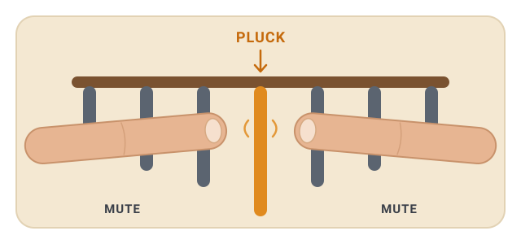

# How to tune your kalimba with Kalimate

A short, practical walkthrough — from download to a fully tuned instrument. No
musical training needed.

## 1. Download and open it

Grab the build for your system from the
[releases page](https://github.com/niespodd/kalimate/releases/latest):

- **macOS** — Apple Silicon or Intel `.zip`
- **Windows** — `.zip` with the `.exe`
- **Linux** — `.tar.xz`

The downloads are unsigned, so the first launch may need a nudge: on macOS
right-click the app → **Open**; on Windows click *More info → Run anyway*.

## 2. Allow the microphone

On first launch Kalimate asks to use your microphone — allow it. That's how it
hears the kalimba; the built-in mic on a laptop or phone is plenty. Nothing is
recorded or sent anywhere: all the listening happens on your machine, offline.

## 3. Start at C4

Kalimate opens on **C4** — the long tine in the middle, the lowest note. It's the
easiest place to start, and working outward from the centre keeps you oriented.
Pluck C4 (or tap any key on the on-screen kalimba map to jump to it), and the big
readout shows the note and how far off you are.

## 4. Get something to move the tine

Most kalimbas come with a **small tuning hammer** — use it. Anything small and
firm that grips the metal will do in a pinch. You tap the tine to move it:

- **Too low?** Tap the tine *in* (shorter free length → higher pitch).
- **Too high?** Tap it *out* (longer → lower pitch).

Kalimate tells you which way on screen, so you never have to remember. Move it in
tiny taps — a fraction of a millimetre shifts the pitch a surprising amount.

## 5. Mute the neighbouring tines

When you pluck one tine, the ones next to it like to ring along, and that muddies
what the tuner hears. Rest a fingertip across the tines on each side of the one
you're tuning — one finger pad comfortably covers two tines — and pluck the target
in the clear gap between them.

  

This is a normal part of kalimba technique, not a trick — you'll do it instinctively
after a few tines.

## 6. For the high notes, get closer to the mic

The short, high tines are much quieter than the long low ones and fade fast. If
Kalimate seems not to hear one, hold the kalimba a little **closer to the
microphone**, mute the neighbours, and give it a firm pluck. That's usually all it
takes for the high keys to register cleanly.

## 7. Pluck a few times, then move on

One pluck can be noisy, so pluck the same tine a few times in a row. Let the
reading settle, tap the tine, and pluck again. When it sits within **±5 cents** the
key goes **green** and locks in on its own — then press **Space / Enter** (or tap
**Next**) to move to the next key and watch the *N of 17 tuned* counter climb.

That's it. Work your way around the instrument and you'll have the whole thing in
tune in a few minutes.
