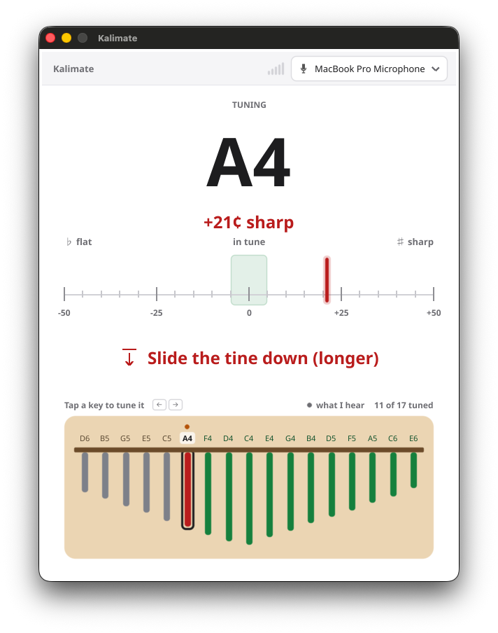

<div align="center">



# Stop fighting with an out-of-tune kalimba

### So easy a tone-deaf person could do it — free on Windows, macOS & Linux

**Kalimate** listens to each pluck, shows you the note and how far off you are, and
tells you **exactly which way to slide the tine**. Free, offline, open source.

<br>

[](https://github.com/niespodd/kalimate/releases/latest/download/Kalimate-macos-arm64.zip)
[](https://github.com/niespodd/kalimate/releases/latest/download/Kalimate-windows-amd64.zip)
[](https://github.com/niespodd/kalimate/releases/latest/download/Kalimate-linux-amd64.tar.xz)

<sub>macOS button is Apple Silicon · [Intel build](https://github.com/niespodd/kalimate/releases/latest/download/Kalimate-macos-amd64.zip) · [all downloads & release notes](https://github.com/niespodd/kalimate/releases/latest)</sub>

### 🪕 [Tuning guide for complete dummies →](HOWTO.md)

</div>

---

## Why it works

No clip-on tuner, no contact pickup - your built-in microphone is just enough. A kalimba tine rings with a strong, clear fundamental, so a laptop or
phone mic picks the pitch up cleanly from across the desk. Hearing the note was never the hard part; the catch is that the metal tine has a sharp, noisy attack and a long, slightly inharmonic decay, so a naive tuner jitters and jumps octaves. Kalimate does that cleanup in software — which is why a plain mic is all you need.

---

<details>
<summary><b>How the measurement works</b></summary>

<br>

A plucked tine can't be trusted on a single reading, so the pluck tracker
(`internal/pitch/tracker.go`) does this per note:

1. **Overlapping analysis** — a 2048-sample YIN window advances every 1024
   samples (~43 readings/sec) for real temporal resolution.
2. **Onset detection** — an adaptive noise floor with hysteresis treats each tap
   as a distinct pluck event.
3. **Attack rejection** — the first ~90 ms (the transient) is discarded.
4. **Median estimate** — the remaining sustain samples are octave-folded to undo
   YIN's occasional octave jumps, then collapsed to one frequency by a plain
   median (deliberately not amplitude-weighted, which would bias toward the sharp
   attack).
5. **Stable, live reading** — the display shows that per-pluck frequency: steady
   for the length of a pluck, refreshed on the next one so a tine you just
   adjusted updates right away. A key is _confirmed_ once its pitch holds within
   ±5 cents continuously for ~400 ms.

</details>

<details>
<summary><b>Build from source</b></summary>

<br>

Requires [Go](https://go.dev/dl/) 1.25+.

```sh
git clone https://github.com/niespodd/kalimate.git
cd kalimate
go run .
```

Or build a standalone binary:

```sh
go build -o kalimate .
./kalimate
```

</details>

<details>
<summary><b>Project layout</b></summary>

<br>

The code is split by concern — display, calculate, interface devices:

- **`internal/audio`** — _interfaces with devices_. Enumerates capture inputs and
  streams raw mono samples (the OS audio input via
  [malgo](https://github.com/gen2brain/malgo) — CoreAudio / WASAPI / ALSA).
- **`internal/pitch`** — _calculates_. Pitch detection, note mapping, and the
  pluck tracker that turns noisy frames into a stable reading.
- **`internal/ui`** — _displays_. The window, tuning meter, and kalimba map. Takes
  a plain `TunerState` struct; knows nothing about audio or math. Translations
  live in `internal/ui/translations/`.
- **`main.go`** — the controller that wires the three together and owns the device
  lifecycle.

**Tuning the tuner.** Knobs live in `internal/pitch` — detection thresholds in
`detect.go` (`yinThreshold`, `rmsGate`) and pluck behavior in `tracker.go`
(`neededPlucks`, `attackMs`, onset multipliers).

**Localization.** UI text is keyed in `internal/ui/translations/en.json` and
resolved through [`fyne.io/fyne/v2/lang`](https://pkg.go.dev/fyne.io/fyne/v2/lang).
To add a language, drop a `<lang>.json` (e.g. `pl.json`) next to `en.json` using
the same keys — it loads automatically on matching systems.

</details>

## Built with


Prebuilt binaries for macOS (Apple Silicon + Intel), Windows, and Linux are on the
[releases page](https://github.com/niespodd/kalimate/releases). Downloaded builds
are unsigned, so first launch may need a right-click → **Open** (macOS) or
_More info → Run anyway_ (Windows).

## License

Kalimate is released under the [MIT License](LICENSE.md). All bundled
dependencies are under permissive licenses (MIT / BSD / ISC / Apache-2.0 /
public domain) — see [LICENSE.md](LICENSE.md) for the full third-party inventory.
